<div align="center">


<br>

**Browser-based, multi-counter point of sale for the NCET campus General Store.**<br>
Replaces Link-Zee 1.0 and follows `NCET_Store_POS_Blueprint.pdf` — now running on **MongoDB Atlas**.

[What's inside](#whats-inside) · [How it works](#how-it-works) · [Rules](#rules) · [Payments](#payments) · [Quick start](#quick-start) · [Counter PCs](#counter-pcs) · [MongoDB](#mongodb-edition) · [Moving data](#moving-data) · [Tests](#tests) · [Trade-offs](#trade-offs) · [Layout](#layout) · [Link-Zee](#link-zee)


</div>


<a name="whats-inside"></a>



<details>
<summary><b>Full feature list</b></summary>

<br>

| | Module | What it does |
|:-:|---|---|
| 🧾 | **Counter sales** | Barcode / code / name search, `5*123` quantities, −/+ steppers, best-seller tiles with in-bill counts, section kits, Cash + UPI + Card split with change, **UPI QR for the exact amount (F3)**, hold / recall, **F10 saves and prints** with no dialog, `Alt+2…0` on laptops, Ctrl+P reprint, Ctrl+L lock |
| 🚚 | **Purchases (GRN)** | GRN number on first save, boxes ↔ pieces, rate **or** line amount, unlimited charges (Transport, Hamali…) spread into landed cost, **posting blocked until within ₹1 of the supplier bill**, store keeper enters → manager posts, barcode label sheets |
| 📦 | **Products & stock** | ~12-field master, GST % + HSN, duplicate-name block, Excel import / export, live stock summary, item ledger with running balance, low / negative / dead stock, expiry report, approved adjustments |
| 📊 | **Reports** | Daily, monthly, sales register, purchase register, section kits + class order sheet, yearly FY stock, **GST input & output registers** — every one on screen, as **PDF** and as **Excel** |
| 🛡️ | **Control** | 4 roles, personal logins, server-side sessions, append-only audit log, who-is-logged-in with end-session, nightly ledger check, manager actions listed on the daily report |
| 🎨 | **Look** | NCET ERP theme (light + dark), collapsible sidebar, Ctrl+K screen search, Table ⇄ Cards view on every list, tablet and phone layouts |

</details>


<a name="how-it-works"></a>


<a name="rules"></a>



<details>
<summary><b>The rules in full</b></summary>

<br>

- The **server clock** sets every bill date — nobody can backdate a bill. Dates show as DD-MM-YYYY (IST).
- **Bill numbers** are per counter per financial year (`C2/26-27/000481`), **gapless**, reset on 1 April.
- A bill is saved **once**: each carries an idempotency key, so a double F10 or a network retry returns the same bill.
- Stock and the stock ledger change **in the same transaction**; the ledger and audit log are **append-only**. A nightly 02:00 check raises a dashboard alert if a balance ever differs from its ledger.
- Cashiers bill at the **master price**; only managers change a price on a bill (with a remark, flagged, logged).
- UPI + card can never exceed the bill; payment rows always add up to the bill.
- Bills are never deleted: cancel writes reversing movements; edits and cancels are same-day and manager-only.
- One supplier invoice can be entered only once. Future invoice dates are refused.
- Personal accounts only; first login forces a new password (Argon2id); 5 wrong passwords lock the username for 10 minutes; Ctrl+L locks the counter **on the server**.
- **Store keepers cannot change stock on their own**: their GRNs, returns and adjustments need a manager.
- Reprints are stamped **DUPLICATE n** and logged. Cashiers never see purchase costs.

</details>


<a name="payments"></a>



<details>
<summary><b>How UPI and card are kept honest</b></summary>

<br>

- **UPI at the counter (F3):** a QR with the store's UPI ID and the exact amount; money goes straight to the store's bank. No card or bank details are typed into or stored by this system.
- **Transaction ID:** every UPI payment records its UTR, and **one ID can back only one completed bill** — checked inside the save transaction, so two counters cannot claim the same payment at once.
- **Reconciliation:** the daily report lists every UPI and card transaction, and collections by mode always add up to net sales.
- **Refunds** go back the way the bill was paid.

</details>


<a name="quick-start"></a>



> Requirements: **Node.js 20+** (tested on 24) and a **MongoDB replica set** — a free MongoDB Atlas cluster works.

```powershell
npm install
copy backend\.env.example backend\.env     # set DATABASE_URL (Atlas mongodb+srv://…/ncet_store), JWT_SECRET, ADMIN_INITIAL_PASSWORD
npm run migrate                             # collections, indexes, partial unique indexes, id sequences
npm run build                               # build first: it also generates the database client
npm run seed                                # admin user, counters C1 C2 C3 OF, units, categories, charge types
npm run seed:demo                           # OPTIONAL training catalogue — not for the live store
npm start                                   # http://<server-ip>:3000
```

Log in as `admin` with `ADMIN_INITIAL_PASSWORD`; you will be asked to set a new password.
For development: `npm run dev:api` and `npm run dev:web` (Vite on :5173 forwards `/api` to :3000).


<a name="counter-pcs"></a>


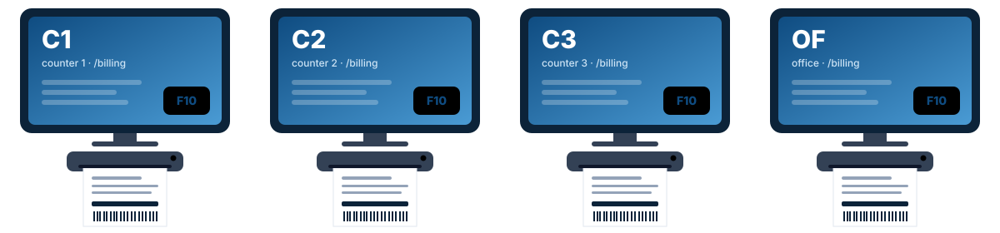

One desktop shortcut per counter, with the 80 mm printer as that PC's default:

```
"C:\Program Files\Google\Chrome\Application\chrome.exe" --kiosk-printing --app=http://<server-ip>:3000/billing
```

<details>
<summary><b>HTTPS and store settings</b></summary>

<br>

**HTTPS on the store network** — create a local certificate (for example with `mkcert`), install its root on each counter PC, and set `HTTPS_CERT_FILE` / `HTTPS_KEY_FILE` in `backend/.env`.

**Store answers (blueprint § 25)** — UPI ID and payee name, GST registration and GSTIN, counters, charge types and the negative-stock rule are all settings under *Masters → Store settings*; no code changes.

</details>


<a name="mongodb-edition"></a>



<details>
<summary><b>Where each guarantee lives in the code</b></summary>

<br>

| PostgreSQL edition | MongoDB edition | Where |
|---|---|---|
| `SERIAL` / auto-increment ids | numeric ids from an atomic `_seq` collection (URLs like `/purchases/22` keep working) | `backend/src/config/prisma.service.ts` |
| `NUMERIC(12,2)` money | Decimal maths everywhere, stored rounded to 4 dp | `backend/src/utils/money.ts` |
| `SELECT … FOR UPDATE` row locks | per-item queue in the one API server + MongoDB transactions retried on write conflict | `backend/src/utils/keyed-lock.ts`, `withTx` |
| triggers making ledger + audit append-only | the database client refuses update / delete on them | `config/prisma.service.ts` |
| partial unique indexes | MongoDB partial indexes: active product name, barcode, GRN no, live supplier invoice | `backend/src/config/mongo-indexes.ts` |
| `INSERT … ON CONFLICT` bill counter | upsert + `$inc` inside the bill's transaction (still gapless) | `backend/src/utils/doc-number.ts` |
| SQL aggregate reports | Prisma `groupBy` / MongoDB `$group` pipelines, figures computed in Decimal | `backend/src/services/reports/service.ts` |
| `NULL` columns | every optional field written as `null`, so `field: null` filters match | `config/prisma.service.ts`, `config/mongo-indexes.ts` |

</details>


<a name="moving-data"></a>



Set `POSTGRES_URL` in `backend/.env` to the old database, then:

```powershell
npm run migrate                              # once, on the empty MongoDB database
npm run migrate:from-postgres -- --wipe      # copies every table, keeps ids, checks every row count
npm run check:stock                          # every product's balance must equal its ledger
```

The copy retries dropped connections batch by batch (each batch is idempotent) and stops on any rejected document. The PostgreSQL schema and migrations are kept in `backend/postgres-legacy/`.


<a name="tests"></a>



<details>
<summary><b>What each test proves</b></summary>

<br>

| Command | What it proves | Result |
|---|---|:-:|
| `npm test` | bill totals (5×35 + 5×10 = 225.00), rounding, payments, landed cost, ₹1 gate, IST dates | ✅ 15 / 15 |
| `npm run smoke` | GRNs, GST registers, roles, maker/checker, idempotency, UPI ID reuse, returns, sessions, every report as JSON / PDF / XLSX, audit trail | ✅ 155 / 155 |
| `node scripts/e2e-ui.mjs` | a real browser: keyboard-only billing, F10, hold / recall, Ctrl+L, every page per role, GRN maker/checker, labels, tablet layout | ✅ 47 / 47 |
| `npm run rush` | 4 counters billing the same items at once with double presses | ⚠️ 12 / 13 — speed, see trade-offs |
| `npm run check:stock` | every product's cached balance equals its ledger | ✅ 0 differences |

`smoke`, `rush` and `e2e-ui` create test records — run them against a development database. They need env `ADMIN_PASSWORD`.

</details>


<a name="trade-offs"></a>



<details>
<summary><b>The details</b></summary>

<br>

- **Billing now needs the internet.** The PostgreSQL edition ran on the store server, so counters kept billing when the campus internet was down (a blueprint goal). With MongoDB Atlas every bill is saved in the cloud. Plan a backup connection, or run MongoDB as a replica set on the store server instead (same code, change `DATABASE_URL`).
- **Bill save time.** Each save makes 15–20 round trips to Atlas (31–218 ms each from the store network). In the rush test — 4 counters selling the same 3 items as fast as possible — **no bill failed, none was saved twice, stock and ledger were exact, numbers gapless**, but the 95th-percentile save time was **2.8 s** against the blueprint's 300 ms (which assumed a local database).
- **One API process.** The per-item queue that replaces row locks lives inside the API server, so run a single instance.
- **Backups.** `ops/backup.sh` is for the PostgreSQL edition. On Atlas use its backups (paid tiers) or a scheduled `mongodump` of `ncet_store`. Free (M0) clusters have no automatic backups.
- Some connections from the store network to Atlas are refused at the TLS handshake. Reads and whole transactions are retried automatically, and the driver retries single writes once (`retryWrites=true`).
- `npm audit` reports advisories in `prisma` (CLI), `exceljs` → `uuid` and `zod`; fixing them needs major upgrades — plan separately with the full test suite.
- PDFs use pdfmake's built-in fonts, so amounts print as "Rs" in PDFs only (screen and Excel use ₹).

</details>


<a name="layout"></a>



The pictures in this README are plain SVG made by `node docs/readme/build.mjs` (except `hero`, `stats`, `bill-flow` and `architecture`, which are hand-made). They respect dark mode and *reduce motion*.


<a name="link-zee"></a>



1. Copy the Link-Zee `.mdb` file and export the Item Master to Excel/CSV.
2. Arrange it into the product sheet layout (*Products → Export Excel* gives the columns), fix spellings, merge duplicates. Keep the old item codes.
3. *Products → Import Excel*. If any row has a problem, nothing is imported and every problem is listed.
4. On cutover day count the shelves and upload the count under *Masters → Go-live tools* (columns `Code`, `Counted Qty`, optional `Cost`).
5. Run both systems for a week and compare daily totals, then switch off Link-Zee.


